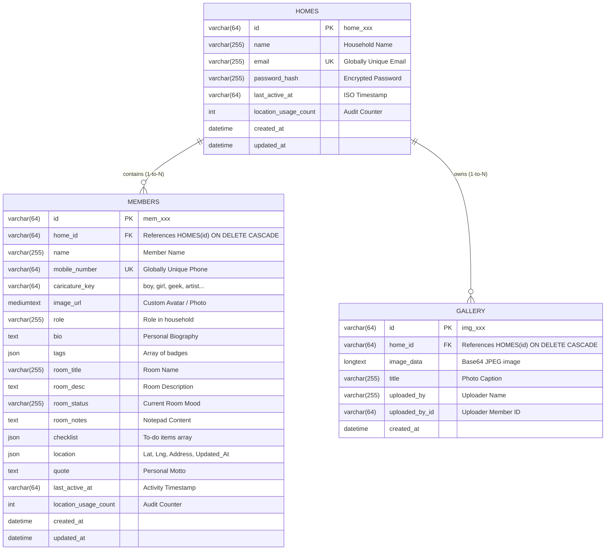

# 🏡 Family Home App — Software Requirements Specification (SRS)
## Version 0.3 (Internet Calling, Background Location Sharing & Automated Testing Architecture)

**Document Version:** 0.3.0  
**Project Name:** Family Home App (Multi-Tenant Web Application & Android APK)  
**Last Updated:** November 2026  
**Status:** In Review & Audit  

---

## 1. Version History & Changelog

| Version | Release Date | Summary of Major Changes |
| :--- | :--- | :--- |
| **v0.1** | October 2026 | Initial baseline single-family release: Master admin access (`2000`), mobile-number member login, live GPS radar, family gallery, room checklists, and Android exit confirmation. Archived in `docs/v0.1/SRS_v0.1.md`. |
| **v0.2** | November 2026 | **Multi-Tenant Platform Transformation:**<br>• Super Admin tier: Platform-wide home directory, inspect member directories, provision homes, set home passwords.<br>• Home Admin registration flow (`Home Name`, unique `Email`, `Password`, `Confirm Password`).<br>• Isolated multi-tenant database scoping (`home_id` foreign key on members & gallery).<br>• Universal modern UI styling across web and Android mobile APK. Archived in `docs/v0.2/SRS_v0.2.md`. |
| **v0.3** | November 2026 | **Calling, Background Mobility & Test Automation Framework:**<br>• **Real-Time Internet Calling:** Browser-to-browser WebRTC mesh audio calling, in-app synthesized melodic chimes, and persistent "Ring Again / Repeat Call" functionality for unjoined members.<br>• **Automatic Background Live Location Sharing:** Automatic GPS broadcast upon member login, persistence across app minimization/backgrounding via Android `ACCESS_BACKGROUND_LOCATION`, `WAKE_LOCK`, and `WebView.resumeTimers()`, and automatic termination on logout.<br>• **Strict Multi-Tenant Authorization:** Enforced backend RBAC on member deletions, photo deletions, and home profile updates preventing unauthenticated or cross-tenant access.<br>• **Resilient Super Admin Provisioning:** Offline/GitHub Pages fallback support for `createHome`, `setHomePassword`, and `deleteHome` with automatic local-cache synchronization.<br>• **Form & Text Contrast Standards:** Form autocomplete isolation against credential manager leakage and `-webkit-text-fill-color` fixes for high-contrast typing across Android/iOS/Web in light and dark modes.<br>• **Automated Testing Hooks:** Full specification for web automation via **Playwright** and mobile automation via **Appium** (standardized `data-testid` convention and Android `setWebContentsDebuggingEnabled`). |

---

## 2. Executive Summary & System Objectives

### 2.1 Purpose
The **Family Home App** is an enterprise-grade, multi-tenant family collaboration platform designed to host independent, private household sanctuaries. Each home operates within a cryptographically isolated tenant boundary featuring real-time status updates, personal room management, interactive to-do checklists, central live family GPS tracking, private photo galleries, and real-time internet audio communication.

### 2.2 Core Design Principles
* **Multi-Tenant Isolation:** Complete cryptographic and logical separation between family households (`home_id` partition). No household can view, edit, or delete data from another household.
* **Super Admin Governance:** Global visibility and home provisioning without exposing master administrative credentials or violating household privacy.
* **Resilience & Local-First Availability:** Full architectural support for offline operation, client-side fallback storage, and static web deployments (GitHub Pages) with transparent local caching.
* **Seamless Ambient Mobility:** Continuous background location tracking without user intervention, surviving mobile app minimization while respecting power and permission constraints.
* **Industry-Standard Testability:** Clean decoupling of UI and testing layers, enabling end-to-end automated test suites in **Playwright** (desktop/mobile web) and **Appium** (native Android APK).

---

## 3. User Roles & Permission Matrix (RBAC)

| Feature / Action | 👑 Super Admin | 🏡 Home Admin | 👤 Family Member | 🌐 Unauthenticated |
| :--- | :---: | :---: | :---: | :---: |
| **Authentication Credential** | Master Password `2000` (Hidden) | Registered Email + Password | Registered Mobile Number | None |
| **List All Platform Homes** | ✅ Full Access | ❌ Forbidden | ❌ Forbidden | ❌ Denied (403) |
| **Provision New Home & Initial Password** | ✅ Full Access | ❌ Forbidden | ❌ Forbidden | ❌ Denied (403) |
| **Register New Home (Self-Service)** | ❌ (Platform console) | ✅ Login Screen | ❌ Forbidden | ✅ Public Access |
| **Reset Home Password** | ✅ Full Access | ✅ Own Home Only | ❌ Forbidden | ❌ Denied (403) |
| **Delete Home Platform-Wide** | ✅ Full Access | ❌ Forbidden | ❌ Forbidden | ❌ Denied (403) |
| **Add / Edit / Delete Home Members** | ❌ Restricted | ✅ Own Home Only | ❌ Forbidden | ❌ Denied (403) |
| **Edit Own Member Profile / Sanctuary** | ❌ Restricted | ✅ Any Home Member | 🔒 Own Profile Only | ❌ Denied (403) |
| **Trigger Internet Family Audio Call** | ❌ Restricted | ✅ Within Home | ✅ Within Home | ❌ Denied (403) |
| **Join / Leave / Repeat Active Call** | ❌ Restricted | ✅ Within Home | ✅ Within Home | ❌ Denied (403) |
| **View Central Live Family GPS Map** | 🔍 Audit usage only | ✅ Full Home Map | ✅ Full Home Map | ❌ Denied (403) |
| **Update Live GPS Coordinates** | ❌ Restricted | ✅ Manual / Pin | 🔄 Automatic on Login | ❌ Denied (403) |
| **Family Gallery: View & Upload Photos** | ❌ Restricted | ✅ Full Access | ✅ Full Access | ❌ Denied (403) |
| **Family Gallery: Delete Photos** | ❌ Restricted | ✅ Any Photo in Home | 🔒 Own Photos ONLY | ❌ Denied (403) |

---

## 4. Module-Wise Functional Requirements

### Module 1: Multi-Tenant Authentication & Form Integrity
* **REQ-1.1 (Home Registration):**
  * Input fields: `Home Name`, `Email` (must be strictly unique across platform, trimmed and case-insensitive), `Password` (>= 3 characters), and `Confirm Password`.
  * Prevents duplicate registration both online against MySQL and offline against cached homes.
* **REQ-1.2 (Home Dedicated Login):**
  * Both Home Email and Password are required.
  * System validates against the latest password hash. In offline/cached scenarios, local cache updates immediately when a new password is set.
* **REQ-1.3 (Super Admin Portal & Confidential Master Key):**
  * Super Admin authenticates using master key `2000`.
  * Master key `2000` is strictly confidential and never displayed in client UI text, placeholders, or helper hints.
* **REQ-1.4 (Family Member Mobile Login):**
  * Members authenticate using their registered mobile number.
  * System maps the mobile number to the corresponding `home_id`, establishing an authenticated tenant session.
* **REQ-1.5 (Input Contrast & Text Visibility):**
  * All input fields, textareas, and select elements MUST render high-contrast, fully visible text (`#0f172a` / `text-slate-900`) across all operating systems (Windows, Android, iOS, macOS) and browser color schemes (Light and Dark Mode).
  * WebKit autofill styling MUST explicitly override user-agent pseudo-classes using `-webkit-text-fill-color: #0f172a !important;` and `-webkit-box-shadow: 0 0 0px 1000px #ffffff inset !important;`.
* **REQ-1.6 (Autofill Isolation & Anti-Prepopulation):**
  * Form inputs for new home creation, password updates, and registration tabs MUST NOT automatically pre-populate with browser-cached administrative or personal credentials.
  * Forms employ decoy credential traps and explicit `autoComplete="new-password"` attributes.

---

### Module 2: Super Admin Platform Management
* **REQ-2.1 (Homes Overview & Directory):**
  * Displays total homes registered, member count per home, and gallery photo count.
  * Real-time metrics compute accurately across both remote MySQL databases and offline local storage partitions.
* **REQ-2.2 (Resilient Home Provisioning):**
  * Super Admin can provision a new home (`Home Name`, `Email`, `Password`).
  * System implements graceful dual-mode execution: writes to remote REST API `/api/super-admin/homes` when connected, and writes to `localStorage` offline cache when offline or hosted statically on GitHub Pages.
* **REQ-2.3 (Password Governance & Immediate Propagation):**
  * Super Admin can reset or assign a new password to any home.
  * Changes propagate instantly to both the remote server and the local client storage mirror, ensuring immediate valid login with the updated password.
* **REQ-2.4 (Cascading Home Deletion):**
  * Deleting a home cascades to all member profiles and gallery images in that household.
  * Deletion operates reliably both on remote databases and within partitioned local storage keys.

---

### Module 3: Home Dashboard & House Layout
* **REQ-3.1 (Dynamic Household Branding):**
  * Displays active home name with role indicators (`👑 Home Admin` or `👤 Member Name`).
* **REQ-3.2 (Visual Cartoon Home):**
  * Centered responsive SVG cartoon home illustration featuring animated chimney smoke puffs and dynamic member occupancy counters.
* **REQ-3.3 (Deduplicated Members Grid):**
  * Displays caricatured profile cards strictly scoped to the active household.
  * Enforces zero duplicate member cards in memory and rendering.

---

### Module 4: Personal Room Sanctuary (`MemberPage`)
* **REQ-4.1 (Two-Tab Profile Structure):**
  * Tab 1: **Personal Story & About** (Bio, role, inspirational quote, registered mobile number).
  * Tab 2: **My Room Sanctuary** (Room description, daily status, personal notepad, and interactive checklist).
* **REQ-4.2 (Interactive Checklist):**
  * Members can add tasks, toggle completion states, and delete checklist items.
  * Updates persist to the member record and synchronize across devices.

---

### Module 5: Central Live Family Geolocation & Map (`MembersMap`)
* **REQ-5.1 (Home-Scoped Geolocation Visibility):**
  * All members and the Home Admin view the household's reported GPS coordinates on a central map tile.
  * Coordinates of other households are completely partitioned.
* **REQ-5.2 (Dual View Modes):**
  * **Google Maps Embed:** Live satellite/street view with interactive zoom and coordinate marker pins.
  * **Family Radar:** Abstract graphical representation showing caricature pins and relative family positions.
* **REQ-5.3 (External Navigation Integration):**
  * "Open Maps ↗" triggers external Google Maps navigation directly to the member's coordinates (`https://www.google.com/maps?q=lat,lng`).

---

### Module 6: Real-Time WebRTC Internet Calling (`FamilyCallingModal`)
* **REQ-6.1 (Mesh Audio Architecture):**
  * Peer-to-peer audio calling powered by browser WebRTC (`RTCPeerConnection`).
  * WebRTC signaling handled via backend REST polling (`/api/calls/:callId/signal` and `/api/calls/:callId/signals`).
  * STUN redundancy provided via Google Public STUN servers (`stun:stun.l.google.com:19302`).
* **REQ-6.2 (In-App Audio Synthesizer):**
  * Zero external audio asset dependencies. Ringtones are generated on-the-fly via the HTML5 Web Audio API (`AudioContext`).
  * **Caller Ringback:** Gentle sine-wave pulse (440Hz / 480Hz).
  * **Callee Incoming Chime:** Cheerful 4-tone melodic arpeggio (C5-E5-G5-C6).
* **REQ-6.3 (Repeat Call / "Ring Again" Feature):**
  * When a call is initiated, unjoined family members see an incoming call banner.
  * If members have not yet answered, the caller or any joined participant can trigger **"Repeat Call" / "Ring Again"**.
  * The system increments the repeat counter and re-triggers the melodic incoming chime across all unjoined devices.
* **REQ-6.4 (Call Controls & Clean Teardown):**
  * Interactive controls: Mute/Unmute microphone, Leave Call, and End Call (for everyone).
  * Full audio track and connection cleanup upon termination to prevent battery and microphone leaks.

---

### Module 7: Automatic Mobile Background Live Location Sharing
* **REQ-7.1 (Automatic Trigger on Login):**
  * When a family member logs into the Android APK or web app, background location sharing initializes automatically.
  * No manual button click required.
* **REQ-7.2 (Lifecycle Persistence & Backgrounding):**
  * When the mobile application is minimized or placed in the background, location sharing continues uninterrupted.
  * Android Manifest declares:
    * `android.permission.ACCESS_FINE_LOCATION`
    * `android.permission.ACCESS_COARSE_LOCATION`
    * `android.permission.ACCESS_BACKGROUND_LOCATION`
    * `android.permission.WAKE_LOCK`
  * Android `MainActivity.java` overrides `onPause()` to invoke `WebView.resumeTimers()` to prevent Android Chrome WebView JavaScript timers from pausing when the app loses focus.
* **REQ-7.3 (Automatic Teardown on Logout):**
  * As soon as the member logs out, all `watchPosition` listeners, heartbeat timers, and background broadcast loops are immediately cleared.

---

### Module 8: Family Administration & Member CRUD
* **REQ-8.1 (Member Provisioning):** Home Admin registers members with Name, Mobile Number, Household Role, Room details, and Caricature avatar.
* **REQ-8.2 (Global Mobile Uniqueness):** Mobile numbers must be globally unique across all households to prevent routing conflicts during member login.
* **REQ-8.3 (Zero-Member Household Resilience):** A newly registered home with 0 members is fully functional and stable.

---

### Module 9: Family Photo Memory Gallery (`FamilyGallery`)
* **REQ-9.1 (Scoped Storage & Client Compression):**
  * Uploaded photos are stored as Base64/longtext scoped to the home's `home_id`.
  * Client-side HTML5 canvas compression resizes photos to a maximum 1200x1200px (JPEG quality 0.82) to ensure rapid upload over cellular connections.
* **REQ-9.2 (Granular Deletion Governance):**
  * **Home Admin:** Permitted to delete ANY photo within their household sanctuary.
  * **Family Member:** Permitted to delete **ONLY photos they personally uploaded** (matched by `uploaded_by_id` or display name).
  * **Backend Enforcement:** The backend API MUST strictly verify `auth.memberId === item.uploaded_by_id` or reject with `403 Forbidden`.

---

### Module 10: Automated Quality Assurance Architecture (Playwright & Appium)

To enable enterprise-grade continuous testing and prevent regressions, the application architecture specifies explicit hooks for **Playwright** (Web) and **Appium** (Hybrid Android Native Mobile).

#### 10.1 Playwright Web Automation Standard
* All interactive DOM elements must provide explicit `data-testid` attributes adhering to the convention: `<module>-<component>-<action>`:
  * Authentication: `data-testid="login-tab-member"`, `data-testid="login-input-mobile"`, `data-testid="login-btn-submit"`
  * Super Admin: `data-testid="sa-btn-create-home"`, `data-testid="sa-modal-create-home"`, `data-testid="sa-input-home-name"`
  * Calling: `data-testid="call-btn-trigger"`, `data-testid="call-modal"`, `data-testid="call-btn-join"`, `data-testid="call-btn-repeat"`
  * Location: `data-testid="map-btn-update-location"`, `data-testid="map-pin-member"`
* Test suites run headlessly against Vite dev server and deployed production URLs.

#### 10.2 Appium Hybrid Mobile Automation Standard
* **Android Remote Debugging Hook:**
  * In `MainActivity.java`, Android WebView remote debugging MUST be enabled:
    ```java
    if (Build.VERSION.SDK_INT >= Build.VERSION_CODES.KITKAT) {
        WebView.setWebContentsDebuggingEnabled(true);
    }
    ```
  * This allows Appium to switch from `NATIVE_APP` context to `WEBVIEW_com.family.home`, reusing 100% of the web `data-testid` locator selectors.
* **Native Accessibility Labels:** Key root elements provide `aria-label` or `accessibilityLabel` for native-layer Appium locators (`MobileBy.AccessibilityId`).

---

## 5. Technical Architecture & Database Schema



---

## 6. Non-Functional Requirements (NFR)

1. **Security & Least Privilege:** No endpoint allows unauthenticated operations. All member and gallery queries strictly enforce `home_id` tenant isolation.
2. **Credential Confidentiality:** Super Admin master password `2000` is strictly confidential and never displayed in UI text or logs.
3. **Local-First Resilience:** In the event of backend network loss or static hosting, client-side fallback storage maintains uninterrupted home creation, login, member updates, and gallery management.
4. **Visual Contrast & Ergonomics:** High-contrast typography (`text-slate-900`) and explicit autofill text-color declarations guarantee complete visibility across mobile screens and desktop browsers.
5. **Testability & Observability:** Deterministic `data-testid` attributes on all interactive controls enable robust Playwright and Appium automation without brittle XPath selectors.
