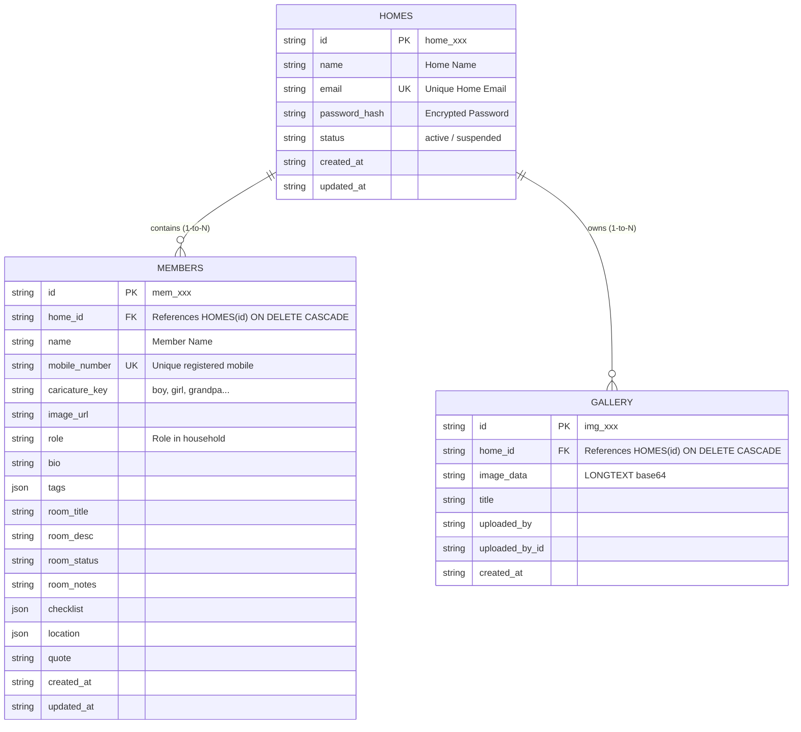

# 🏡 Family Home App — Software Requirements Specification (SRS)
## Version 0.2 (Multi-Tenant Platform with Super Admin & Home Registration)

**Document Version:** 0.2.0  
**Project Name:** Family Home App (Multi-Tenant Web Application & Android APK)  
**Last Updated:** November 2026  
**Status:** Approved & Implemented (Local Environment)  

---

## 1. Version History & Changelog

| Version | Release Date | Summary of Changes |
| :--- | :--- | :--- |
| **v0.1** | October 2026 | Initial baseline: single-family home, master admin `2000`, member phone login, live GPS radar, gallery, room checklists, mobile back-button exit dialog. Archived in `docs/v0.1/SRS_v0.1.md`. |
| **v0.2** | November 2026 | **Multi-Tenant Platform Transformation:** • Super Admin tier: lists all homes, views member details per home, provisions homes, and sets home passwords. • Super Admin master password set to `2000` (strictly hidden from all client UI text). • Home Admin registration flow on login screen (`Home Name`, unique `Email`, `Password`, `Confirm Password`). • Home Admin dedicated password-based login. • Isolated multi-tenant database scoping (`home_id` foreign key on members & gallery). • Universal modern UI styling across web and Android mobile APK without adding or removing features. Active in `docs/v0.2/SRS_v0.2.md`. |

---

## 2. Executive Summary & Objectives

### 2.1 Purpose
The **Family Home App** is a private, multi-tenant family collaboration platform designed to host multiple independent household sanctuaries. Each home enjoys an isolated, secure environment featuring real-time status updates, personal room management, interactive to-do checklists, live family GPS tracking, and private photo galleries.

### 2.2 Core Design Principles
* **Multi-Tenant Isolation:** Complete data separation between family homes (`home_id` scoping).
* **Super Admin Governance:** Global visibility and home provisioning without exposing administrative credentials.
* **Streamlined Home Onboarding:** Easy self-service home registration with unique email and password.
* **Frictionless Family Member Access:** Members log in using their registered mobile numbers and are automatically routed to their family's home.
* **Universal Production Aesthetics:** Clean, modern, universally appealing visual language across desktop browsers and native Android APK.
* **Strict Feature Fidelity:** Existing functionality (GPS radar, cartoon home, gallery, checklists, offline fallback, exit modal) is preserved with zero feature bloat or deletion.

---

## 3. User Roles & Permission Matrix (RBAC)

| Feature / Action | 👑 Super Admin | 🏡 Home Admin | 👤 Family Member |
| :--- | :---: | :---: | :---: |
| **Authentication Credential** | Master Password `2000` (Hidden) | Registered Email + Password (Both Mandatory) | Registered Mobile Number |
| **List All Platform Homes** | ✅ Full Access | ❌ No | ❌ No |
| **Provision New Home & Set Password** | ✅ Full Access | ❌ No | ❌ No |
| **Enter Home Action** | 🛡️ Dedicated Home Audit View (Activity & Location logs only) | 🏡 Home Dashboard | 👤 Member View |
| **Inspect User Personal Secrets / Details** | ❌ Restricted by Policy | 🔒 Own Home Only | 🔒 Own Profile Only |
| **Delete Home Platform-Wide** | ✅ Full Access | ❌ No | ❌ No |
| **Add / Edit / Delete Home Members** | ❌ (Platform only) | ✅ Own Home Only | ❌ No |
| **View Home Dashboard & Cartoon Home** | 🔍 Via Audit Console | ✅ Full Access | ✅ Full Access |
| **View Live Family GPS Radar** | 🔍 Usage Counts in Audit | ✅ Full Access (Home) | ✅ Full Access (Home) |
| **Update Personal Live GPS Location** | ❌ No | ✅ Yes (Home) | ✅ Yes (Own Location) |
| **View Room Details & Sanctuaries** | ❌ Restricted by Policy | ✅ Any Home Member | 🔒 Own Room Only |
| **Edit Room Notes & Personal Checklist**| ❌ Restricted by Policy | ✅ Any Home Member | 🔒 Own Room Only |
| **Family Gallery: View & Upload** | ❌ No | ✅ View & Upload All | ✅ View & Upload All |
| **Family Gallery: Delete Photos** | ❌ No | ✅ Delete ANY Photo in Home | 🔒 Delete OWN Photos ONLY |

---

## 4. Module-Wise Functional Requirements

### Module 1: Multi-Tenant Authentication & Registration
* **REQ-1.1 (Home Registration):**
  * The login interface provides a clear **"Register New Home"** action.
  * Form fields: `Home Name`, `Email` (Home Email, must be unique), `Password`, and `Confirm Password`.
  * Submitting creates a new record in `homes` table and logs the user directly in as Home Admin.
* **REQ-1.2 (Home Admin Dedicated Login):**
  * Home Admins authenticate using their registered Email and Password.
  * Dedicated, password-based authentication.
* **REQ-1.3 (Super Admin Portal & Password):**
  * Super Admin authenticates using master password `2000`.
  * **Critical:** Password `2000` is strictly hidden and **NEVER displayed anywhere** in client UI text, placeholders, or hints.
* **REQ-1.4 (Family Member Mobile Login):**
  * Family members log in using their registered mobile number.
  * System identifies the member and their linked `home_id`, automatically loading their specific family home.
* **REQ-1.5 (Session Persistence & Logout):**
  * Active sessions (`role`, `homeId`, `homeName`, `memberId`) persist in client storage across app restarts and browser reloads.
  * Explicit logout clears credentials and returns to the login screen.

### Module 2: Super Admin Platform Management
* **REQ-2.1 (Homes Overview & Metrics):**
  * Displays total homes registered, total family members, and overall system status.
  * Lists all homes with Home Name, Email, Member Count, Photo Count, and Registration Date.
* **REQ-2.2 (Inspect Home Members):**
  * Super Admin can expand/inspect any home to view all member profiles inside that home (caricatures, names, phone numbers, roles, room status).
* **REQ-2.3 (Provision New Home):**
  * Super Admin can create a new home from the platform console (`Home Name`, `Email`, `Password`).
* **REQ-2.4 (Manage / Reset Home Password):**
  * Super Admin can set or reset the password for any home.
* **REQ-2.5 (Delete Home):**
  * Deletes a home with cascading deletion of all associated members and gallery photos.

### Module 3: Home Dashboard & House Layout (Multi-Tenant Scoped)
* **REQ-3.1 (Dynamic Home Header):**
  * Displays the specific Home Name (e.g. *"The Miller Family Home"*) with user role indicator (`👑 Home Admin` or `👤 Member Name`).
* **REQ-3.2 (Interactive Cartoon Home):**
  * Centered visual cartoon home illustration with chimney smoke animations and dynamic member count.
* **REQ-3.3 (Scoped Members Grid):**
  * Displays member cards belonging strictly to the active home.
  * Unified *"Tap to open profile"* prompt.
  * Shows clean empty state when no members have been registered yet.

### Module 4: Personal Room & Profile Management (`MemberPage`)
* **REQ-4.1 (Focused Two-Tab Layout):**
  * Tab 1: **Personal Story & About** (Bio, role, quote, registered mobile number).
  * Tab 2: **My Room Sanctuary** (Room description, daily status, personal notepad, and to-do checklist).
* **REQ-4.2 (Single Arrow Navigation):**
  * Back to Home button uses a clean single-arrow icon (`Back to Home`).
* **REQ-4.3 (Interactive Checklist):**
  * Members add tasks, toggle completion states, and delete items.

### Module 5: Live Family Geolocation & Central Map (`MembersMap`)
* **REQ-5.1 (Home-Scoped Location Visibility):**
  * All members and Admin of a home view their family's reported locations on the centralized Home Page Google Location Tile.
  * Complete isolation: coordinates from other homes are never visible.
* **REQ-5.2 (Interactive Google Maps Integration):**
  * Embedded live Google Maps view with selectable caricature quick-pins.
* **REQ-5.3 (One-Click "Update My Location"):**
  * Queries device GPS (`navigator.geolocation`) and updates coordinates for the active user in the database.

### Module 6: Real-Time Cross-Device Synchronization
* **REQ-6.1 (Continuous Data Sync):**
  * Background synchronization loop polls the backend API every 2.5 seconds.
  * Updates to member profiles, statuses, checklists, or photos reflect simultaneously across all active devices in that home.
* **REQ-6.2 (Active Session Re-alignment):**
  * When an active user's details are edited, their active session refreshes automatically.

### Module 7: Mobile App Lifecycle & Redirection
* **REQ-7.1 (Hardware Back Button Navigation):**
  * Pressing the system back button on child screens returns to the Home Dashboard.
* **REQ-7.2 (Exit Confirmation Popup):**
  * Pressing back on the root Home screen triggers confirmation dialog:
    *"Do you want to close the app? Your login session will be kept safe when you reopen."*
  * Options: **[Cancel]** and **[Close App]**.

### Module 8: Family Administration & Member CRUD
* **REQ-8.1 (Add Member):** Home Admin registers members with Name, Mobile Number, Role, Room details, and Caricature avatar.
* **REQ-8.2 (Edit Member):** Home Admin can modify any profile; members can modify their own details.
* **REQ-8.3 (Zero-Member Tolerance):** Homes can safely have 0 members while remaining fully operational for the Home Admin.
* **REQ-8.4 (Identity Integrity):** Unique constraint on `mobile_number` across members.

### Module 9: Family Photo Memory Gallery (`FamilyGallery`)
* **REQ-9.1 (Home-Scoped Photo Uploads):** Photos uploaded belong exclusively to the active home.
* **REQ-9.2 (Dual Attribution & Lightbox):** Captions, uploader display name, durable `uploaded_by_id`, and full-screen lightbox modal.
* **REQ-9.3 (Deletion Rules):** Home Admins can delete any photo in their home; members can delete their own uploaded photos.

---

## 5. Technical Architecture & Database Schema

---

## 6. Non-Functional Requirements (NFR)

1. **Local-First Staging:** All modifications and feature iterations are tested strictly in the local environment before any remote push.
2. **Credential Privacy:** Super Admin master password `2000` is strictly confidential and never displayed or referenced in UI copy.
3. **Multi-Tenant Security:** Every API query on `members` and `gallery` must enforce strict `home_id` isolation.
4. **Resilience & Safe Mode:** Full in-memory fallback maintains home registration, member management, and gallery when offline.
5. **Universal Styling:** Visual polish utilizing responsive Tailwind CSS, subtle ambient lighting, rounded glassmorphism, and clear typography.
