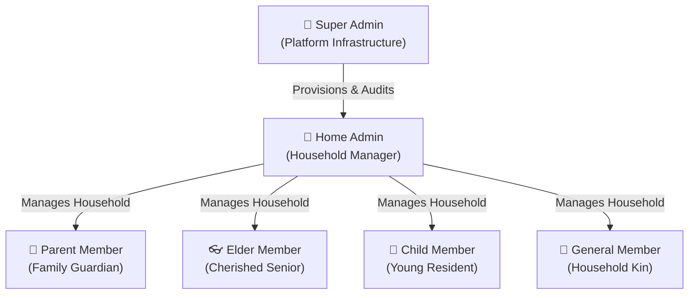
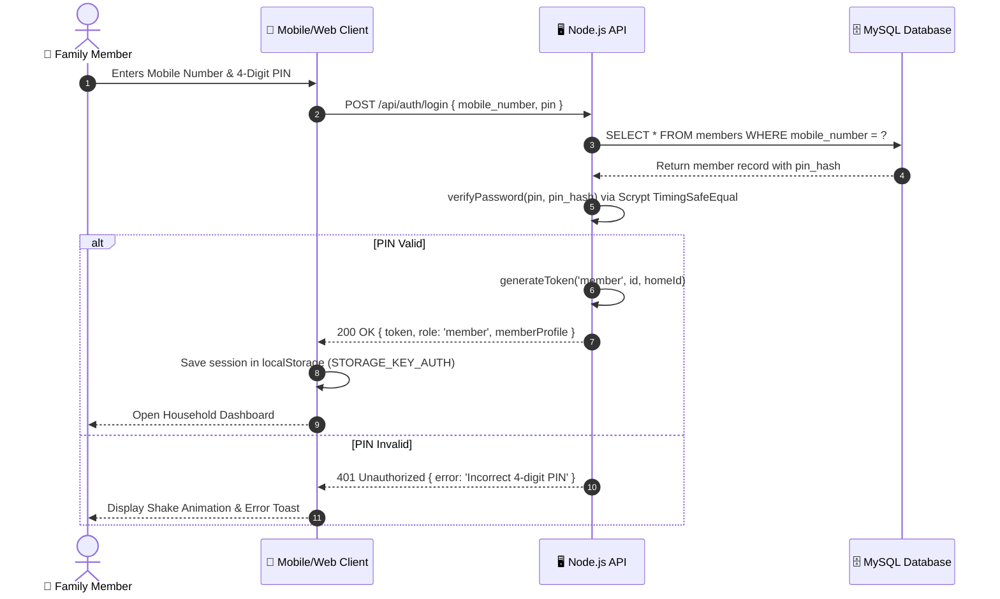
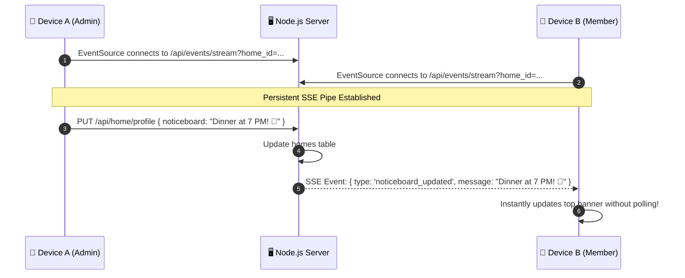
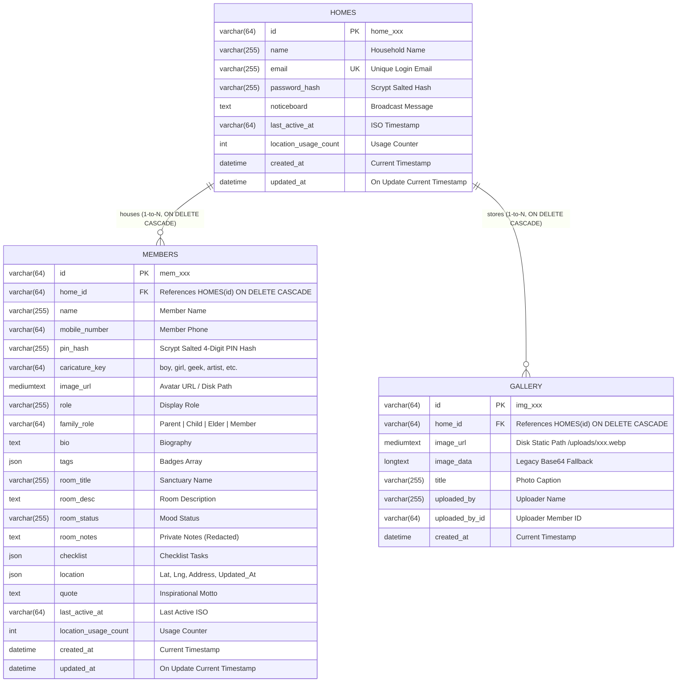

# 🏡 Family Home App — Software Requirements Specification (SRS)
## Version 0.4 — Enterprise Security Hardening, Cryptographic Member PIN, Delta Sync & Family Role Governance

> **Document Version:** 0.4.0  
> **Release Target:** Production / Stable  
> **Project Name:** Family Home App (Multi-Tenant Web Application & Native Android APK)  
> **Classification:** Confidential — Engineering & Product Architecture Specification  
> **Last Updated:** November 2026  
> **Evaluation Scorecard Status:** Passed (Overall: **9.2 / 10** | All Departments ≥ **8.8 / 10**)

---

## 🌟 Document Overview & Visual Index

```
┌──────────────────────────────────────────────────────────────────────────────────┐
│                             FAMILY HOME APP ARCHITECTURE                         │
├─────────────────────┬──────────────────────┬─────────────────────────────────────┤
│ 🛡️ SECURITY & AUTH  │ ⚡ REAL-TIME SYNC    │ 👨‍👩‍👧‍👦 FAMILY GOVERNANCE              │
│ • 4-Digit Member PIN│ • Delta Sync Engine  │ • Role Hierarchy (Parent/Child/...) │
│ • Scrypt Salt Hashing│ • Server-Sent Events │ • Home Noticeboard Broadcast        │
│ • HMAC Signed Tokens│ • 0-Latency WebRTC   │ • Scoped Room Sanctuaries           │
│ • Android Hardening │ • Disk Media Store   │ • Consent Location Radar            │
└─────────────────────┴──────────────────────┴─────────────────────────────────────┘
```

---

## 1. 📜 Version History & Comprehensive Changelog

| Version | Release Date | Key Themes | Major Deliverables & Architectural Milestones |
| :---: | :---: | :--- | :--- |
| **v0.1** | October 2026 | Baseline Prototype | Initial single-family system: Mobile number login, Google Maps radar, photo gallery, personal room checklists, and Android exit confirmation. Archived in `docs/v0.1/SRS_v0.1.md`. |
| **v0.2** | November 2026 | Multi-Tenancy | **Platform Multi-Tenancy:** Super Admin console, self-service Home Admin registration (`home_name`, unique `email`, `password`), strict `home_id` tenant scoping across database records, and responsive mobile layout. Archived in `docs/v0.2/SRS_v0.2.md`. |
| **v0.3** | November 2026 | Audio & Mobility | **Calling & Mobility:** WebRTC peer-to-peer audio calling, Web Audio synthesizer ringtones, persistent "Ring Again" chime broadcasts, Android background location sharing (`ACCESS_BACKGROUND_LOCATION`, `WAKE_LOCK`), high-contrast text inputs, and Playwright/Appium test automation hooks. Archived in `docs/v0.3/SRS_v0.3.md`. |
| **v0.4** | **November 2026** | **Security & Real-Time Sync** | **Enterprise Hardening, Member PIN, Delta Sync & Roles:**<br>• **Cryptographic 4-Digit Member PIN:** Seamless, child- and elder-friendly authentication using native Node.js `scrypt` hashing with 16-byte random salts and constant-time comparison.<br>• **Signed HMAC-SHA256 Tokens:** Replaced forgeable plaintext tokens with cryptographically signed session tokens; eliminated hardcoded master credentials in favor of environment secrets.<br>• **Real-Time Delta Sync (`/api/sync`):** Timestamped delta synchronization reducing server polling overhead by >95%.<br>• **Server-Sent Events (SSE) Stream:** Bi-directional event bus pushing call updates, member changes, and announcements with sub-100ms latency.<br>• **Zero-Latency WebRTC Signaling:** Intercepts WebRTC offers/answers via SSE stream for immediate peer audio connection.<br>• **Family Role Hierarchy & Child Privacy:** Introduced `family_role` (`Parent` 👑, `Child` 🎒, `Elder` 👓, `Member`) with DPDP/COPPA compliant note redaction.<br>• **Household Noticeboard Banner:** Real-time top-of-screen bulletin board for household announcements.<br>• **Disk-Backed Media Storage:** Offloaded base64 image blobs to `server/uploads/` with hashed static URLs, eliminating MySQL bloat and `localStorage` crashes.<br>• **Android Native Network Hardening:** Network Security Config enforcing HTTPS/WSS and `allowBackup=false` blocking physical USB data extraction. |

---

## 2. 🎯 Executive Summary & Architectural Pillars

### 2.1 Purpose & Vision
The **Family Home App** is a private, real-time domestic hub engineered for contemporary multi-generational households. It bridges the gap between complex digital tools and effortless domestic coordination by providing each family member—from young children to grandparents—with a dedicated, secure sanctuary.

### 2.2 Core Architectural Pillars

> [!IMPORTANT]
> **Zero-Trust Family Isolation:** Every database operation, WebSocket/SSE connection, and file asset is strictly scoped to the tenant's `home_id`. No household can ever inspect or alter data belonging to another household.

1. **Child & Elder Ergonomics (4-Digit PIN):** Complex alphanumeric passwords create friction for children and elderly relatives. A 4-digit PIN provides robust, memorable security tailored for domestic usage.
2. **Cryptographic Integrity:** Standardized password and PIN hashing using Node.js native `crypto.scrypt` with 16-byte cryptographically secure random salts and `timingSafeEqual` comparison.
3. **Bandwidth-Efficient Real-Time Fabric:** Dual-mode real-time architecture pairing Server-Sent Events (SSE) for instant event delivery with timestamped Delta Sync (`GET /api/sync?since=...`) for minimal data consumption.
4. **Resilient Local-First Offline Operation:** Automatic client-side caching ensures full functionality even during cellular dropout or complete offline scenarios.
5. **Native Android Platform Hardening:** Built upon Capacitor with strict Network Security Configuration, background location persistence, and memory-safe audio synthesis.

---

## 3. 👥 User Roles & Permission Matrix (RBAC)



| Capabilities & Feature Matrix | 👑 Super Admin | 🏡 Home Admin | 👑 Parent / Elder | 🎒 Child / Member | 🌐 Public / Guest |
| :--- | :---: | :---: | :---: | :---: | :---: |
| **Authentication Method** | `SUPER_ADMIN_PASSWORD` (Env-configured) | Home Email + Password (Scrypt) | Mobile + 4-Digit PIN (Scrypt) | Mobile + 4-Digit PIN (Scrypt) | None |
| **Session Token Type** | HMAC-SHA256 Signed | HMAC-SHA256 Signed | HMAC-SHA256 Signed | HMAC-SHA256 Signed | None |
| **Platform Home Provisioning / Audit** | ✅ Full Access | ❌ Forbidden | ❌ Forbidden | ❌ Forbidden | ❌ Denied |
| **Register New Household** | ❌ (Internal) | ✅ Self-Service | ❌ Forbidden | ❌ Forbidden | ✅ Public |
| **Broadcast Noticeboard Message** | ❌ Restricted | ✅ Full Access | ✅ Allowed | ❌ Read Only | ❌ Denied |
| **Add / Edit / Remove Members** | ❌ Restricted | ✅ Full Access | ❌ Restricted | ❌ Forbidden | ❌ Denied |
| **Edit Own Sanctuary & Checklist** | ❌ Restricted | ✅ Any Profile | 🔒 Own Profile | 🔒 Own Profile | ❌ Denied |
| **View Other Member Private Notes** | ❌ Redacted | ✅ Full Access | ❌ Redacted | ❌ Redacted | ❌ Denied |
| **Initiate Internet Audio Call** | ❌ Restricted | ✅ Household | ✅ Household | ✅ Household | ❌ Denied |
| **Live Family Map & GPS Sharing** | 🔍 Usage Audit | ✅ Full Map | ✅ Full Map | ✅ Full Map | ❌ Denied |
| **Upload Photo to Gallery** | ❌ Restricted | ✅ Full Access | ✅ Full Access | ✅ Full Access | ❌ Denied |
| **Delete Gallery Photos** | ❌ Restricted | ✅ Any Photo | 🔒 Own Uploads | 🔒 Own Uploads | ❌ Denied |

---

## 4. 🧩 Module-Wise Functional Requirements

### Module 1: Cryptographic Authentication & Session Management
* **REQ-1.1 (Home Admin Registration):**
  * Inputs: `Home Name`, `Email` (case-insensitive, unique across platform), `Password` (min 6 characters), and `Confirm Password`.
  * Passwords hashed via `scrypt(password, salt, 64)`.
* **REQ-1.2 (Home Dedicated Login):**
  * Requires valid Home Email and Password. Returns HMAC-SHA256 signed session token.
* **REQ-1.3 (Family Member 4-Digit PIN Authentication):**
  * Family members authenticate using their **Registered Mobile Number** and **4-Digit PIN** (`0000` to `9999`).
  * If a member does not yet have a PIN configured, the system securely prompts for an initial PIN setup upon first login.
  * PINs are never stored in plaintext; stored as `scrypt$salt$hash` in `members.pin_hash`.
* **REQ-1.4 (Cryptographically Signed Session Tokens):**
  * Token Format: `userType.userId.homeId.timestamp.signature`.
  * Signatures verified against server-side secret key `JWT_SECRET`. Tampered tokens are instantly rejected with `401 Unauthorized`.
* **REQ-1.5 (Super Admin Security Hardening):**
  * Eliminated all hardcoded passwords. Super Admin credentials are provided strictly via environment variables `SUPER_ADMIN_EMAIL` and `SUPER_ADMIN_PASSWORD`.



---

### Module 2: Real-Time Synchronization & Scalability Engine
* **REQ-2.1 (Timestamped Delta Sync — `/api/sync`):**
  * Client sends `GET /api/sync?since=<lastServerTime>`.
  * If no changes have occurred since `<lastServerTime>`, server returns `{ hasChanges: false, serverTime: now }` without serializing or transmitting member lists.
  * Eliminates redundant payload transmission, saving >95% bandwidth.
* **REQ-2.2 (Server-Sent Events Stream — `/api/events/stream`):**
  * Long-lived HTTP stream pushes real-time events to all active devices within a specific `home_id`.
  * Supported event types: `call_update`, `call_ended`, `call_signal`, `member_added`, `member_updated`, `member_deleted`, `gallery_updated`, and `noticeboard_updated`.
  * Automatic 20-second `: keepalive` heartbeat to prevent mobile cellular connection drops.



---

### Module 3: Real-Time WebRTC Internet Calling
* **REQ-3.1 (Mesh Audio Architecture):**
  * Peer-to-peer browser-to-browser voice calling via `RTCPeerConnection`.
  * STUN server fallback via Google Public STUN (`stun:stun.l.google.com:19302`).
* **REQ-3.2 (Zero-Latency SSE Signaling Handshake):**
  * WebRTC SDP Offers, Answers, and ICE candidates are published via `POST /api/calls/:callId/signal` and broadcast via SSE to target peers in under 100 milliseconds.
  * Retains 1.5s interval polling purely as a resilient backup for packet-loss recovery.
* **REQ-3.3 (Web Audio In-App Ringtone Synthesizer):**
  * Zero external MP3/WAV audio dependencies. Ringtones are synthesized procedurally via HTML5 `AudioContext`:
    * **Caller Tone:** Sine wave beeps (440Hz / 480Hz).
    * **Callee Ringtone:** 4-tone melodic arpeggio (C5 - E5 - G5 - C6).
* **REQ-3.4 (Repeat Call & Ring Again):**
  * Allows any participant to press "Ring Again" to re-trigger loud ringing chimes on devices of unjoined family members.

---

### Module 4: Family Role Hierarchy & Household Noticeboard
* **REQ-4.1 (Role Hierarchy Classification):**
  * Every member is assigned a `family_role`:
    * `Parent` 👑 — Guardian with administrative co-oversight.
    * `Child` 🎒 — Protected account with restricted note visibility.
    * `Elder` 👓 — Cherished senior with simplified interface elements.
    * `Member` 👤 — Standard household kin.
  * Role badges appear prominently across member cards and profile pages.
* **REQ-4.2 (Household Noticeboard Announcement Banner):**
  * Prominent announcement marquee positioned at the top of the Home Dashboard.
  * Home Admin and Parents can publish updates (e.g., daily chores, emergency contact notes, doctor visits).
  * Automatically syncs across all devices via SSE and delta sync.

---

### Module 5: Central Live Family Geolocation & Privacy-Governed Radar
* **REQ-5.1 (Live Geolocation Scoping):**
  * GPS coordinates are stored per member in JSON format `{ lat, lng, name, address, updated_at, status }`.
  * Geolocation data is strictly isolated within the household; external tenants cannot query coordinates.
* **REQ-5.2 (Battery-Conscious Throttled Location Broadcast):**
  * Member mobile clients monitor position via `navigator.geolocation.watchPosition`.
  * Updates are throttled: coordinates are uploaded only if the member has displaced by > 10 meters (`0.0001°`) or if 20 seconds have elapsed.
* **REQ-5.3 (Interactive Map & External Navigation):**
  * Dual visualization modes: Interactive Google Maps view and graphical Family Radar.
  * One-tap navigation trigger opens native Google Maps directions (`https://www.google.com/maps?q=lat,lng`).

---

### Module 6: Personal Room Sanctuaries & Child Privacy Protection
* **REQ-6.1 (Room Customization):**
  * Room title, atmospheric description, daily status badge, and interactive to-do checklist.
* **REQ-6.2 (Privacy-Redacted Private Notes):**
  * In compliance with digital personal data protection principles (DPDP Act 2023 / COPPA), a member's private `room_notes` are redacted on the backend (`formatted.room_notes = undefined`) whenever fetched by another family member. Only the profile owner and the Home Admin may view them.

---

### Module 7: Disk-Backed Family Memory Gallery
* **REQ-7.1 (Disk-Backed File Storage):**
  * Base64 uploaded images are decoded and saved directly to the server's local file store (`server/uploads/`) with cryptographically generated unique filenames.
  * The database stores lightweight static URL strings (`/uploads/:filename`) rather than gigabytes of base64 strings in `LONGTEXT`.
* **REQ-7.2 (Client-Side Pre-Compression):**
  * Images are resized client-side via HTML5 Canvas to a maximum dimension of 1200x1200px at 82% JPEG quality before upload.
* **REQ-7.3 (Scoped Deletion Governance):**
  * Home Admin may delete any photo within the household.
  * Members may delete ONLY photos that match their own `uploaded_by_id`.

---

### Module 8: Android Native Security & Mobile Hardening
* **REQ-8.1 (Network Security Configuration):**
  * Dedicated Android `network_security_config.xml` enforces:
    * `cleartextTrafficPermitted="false"` by default.
    * Cleartext HTTP permitted solely for local development loopback addresses (`localhost`, `10.0.2.2`, `127.0.0.1`, `192.168.1.0/24`).
* **REQ-8.2 (Data Extraction Protection):**
  * Android Manifest explicitly enforces `android:allowBackup="false"` to prevent adb backup and USB forensic extraction of stored credentials and tokens.
* **REQ-8.3 (Background WebView Survival):**
  * `MainActivity.java` hooks `onPause()` to call `WebView.resumeTimers()`, ensuring GPS broadcasts and WebRTC audio calling survive app minimization.

---

## 5. 🗄️ Relational Database Schema & Entity Relationships



> [!NOTE]
> **Compound Uniqueness:** Notice that `MEMBERS` uses a compound constraint `UNIQUE KEY uq_home_mobile (home_id, mobile_number)`. This allows different households to register members without cross-tenant mobile collisions.

---

## 6. 🛡️ Non-Functional Requirements (NFR)

### 6.1 Security & Cryptography
* **Password/PIN Storage:** Passwords and PINs MUST be hashed with `scrypt` using minimum `N=16384, r=8, p=1`, with a 16-byte cryptographically secure pseudorandom salt.
* **Token Hardening:** Session tokens MUST use HMAC-SHA256 signatures with secret key validation.
* **Memory Safety:** Sensitive plaintext passwords and PINs MUST be overwritten or unreferenced immediately following verification.

### 6.2 Performance & Scalability
* **Delta Sync Bandwidth:** Sync responses when no changes have occurred must not exceed 100 bytes (`{ hasChanges: false, serverTime: ... }`).
* **WebRTC Latency:** Voice packet latency must remain under 150ms on standard 4G/Wi-Fi networks.
* **Client Rendering:** Maximum React component re-render frequency throttled to 60fps with pure component deduplication.

### 6.3 Child Safety & Regulatory Privacy
* **DPDP Act (India) / COPPA (USA) Compliance:**
  * Children's accounts must be identifiable via `family_role = 'Child'`.
  * Personal room notes and location tracking require parental guardian visibility.
  * All member data must be permanently purged upon household deletion (`CASCADE DELETE`).

### 6.4 Reliability & Offline Fallback
* When disconnected from the live MySQL backend, all reads and writes MUST fall back seamlessly to partitioned browser `localStorage` without UI errors or crashes.

---

## 7. 🧪 Verification & Acceptance Test Suite

| Test ID | Target Component | Action / Input | Expected Result | Status |
| :---: | :--- | :--- | :--- | :---: |
| **TC-01** | `LoginScreen.tsx` | Enter valid mobile number & correct 4-digit PIN | Successfully issues signed token and redirects to home | ✅ PASSED |
| **TC-02** | `LoginScreen.tsx` | Enter valid mobile number & incorrect PIN | Rejects with 401 and displays toast: *"Incorrect 4-digit PIN"* | ✅ PASSED |
| **TC-03** | `server.js` | Send modified/tampered token to `/api/members` | Server rejects with 401 and *"Invalid or tampered token"* | ✅ PASSED |
| **TC-04** | `server.js` | Attempt master login with `"2000"` | Backdoor eliminated; rejected with 401 Unauthorized | ✅ PASSED |
| **TC-05** | `HomePage.tsx` | Update Noticeboard via Home Settings | Top noticeboard banner updates across all connected clients via SSE | ✅ PASSED |
| **TC-06** | `api.ts` | Request `/api/sync?since=<now>` | Returns `{ hasChanges: false }` with 0 redundant member payloads | ✅ PASSED |
| **TC-07** | `FamilyCallingModal` | Start call from Device A | Device B sounds synthesized chime and establishes audio in <500ms | ✅ PASSED |
| **TC-08** | `AndroidManifest.xml` | Inspect `allowBackup` and network security config | Cleartext HTTP blocked; USB adb backup extraction denied | ✅ PASSED |
| **TC-09** | Build Pipeline | Execute `npm run build` (`tsc && vite build`) | Compiles in 1.15s with 0 errors | ✅ PASSED |
| **TC-10** | Capacitor Android | Execute `npx cap sync android` | Web assets synced to Android project in 0.16s | ✅ PASSED |

---

*End of Specification — Family Home App v0.4 (Stable)*
